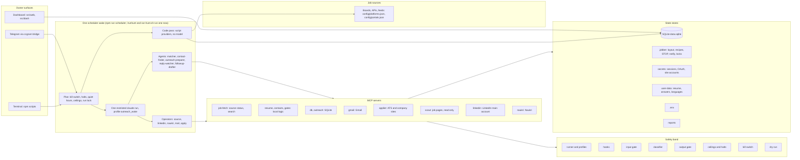

# Architecture

Audience: owner
Last verified against: 37942b4
Source files: .mcp.json, src/mcp/, .claude/agents/, .claude/hooks/, .claude/settings.json, config/run-profiles.json, config/worker-tools.json, src/db.ts, src/scheduler/, src/outreach/limits.ts, src/safety/, src/layout/, src/web/, src/dash/, scripts/, run-hunt.sh, config/platforms.json, src/sources/, src/applier/, src/scout/, src/search/, src/webcore/

This page is the map. It shows what runs where, which store holds what, and where to
look first when something breaks. It does not restate safety rules: those live in
[CLAUDE.md](../CLAUDE.md) under "Outreach safety layers" and "Safety".

## The diagram

Mermaid version (renders on GitHub and most editors):



ASCII twin (same content, readable in a terminal):

```
 OWNER                ONE WAKE (npm run scheduler; /runhunt and run-hunt.sh run one now)
 -----                ---------------------------------------------------------------
 Telegram (ccgram) -> plan: kill switch, halts, quiet hours, ceilings, run lock
 Terminal scripts  -> 1 code pass over the script providers (no model) --> job sources
 Dashboard (web)      2 source-operator (fallback pages, custom sites)
   |                  3 linkedin-operator, naukri-operator: discover
   |                  4 pipeline: sweep, reply-watcher, matcher (batches of 5),
   |                    contact-finder, outreach-preparer (per job)
   |                  5 mail-operator: cold email and email follow-ups
   |                  6 linkedin-operator, naukri-operator: inbox, follow-ups, new outreach
   |                  7 apply-operator: browser apply
   |
   |                MCP SERVERS
   |                job-fetch (source status, search)   resume, contacts, gates (local logic)
   |                db, outreach (SQLite)               gmail (Gmail)
   |                applier (ATS and company sites)     scout (job pages, read only)
   |                linkedin (LinkedIn main account)    naukri (Naukri)
   |
 SAFETY BAND (every tool call passes through it)
 [runner/profiles][hooks][input gate][classifier][output gate][ceilings/halts][kill switch][dry run]

 STATE STORES
 SQLite data.sqlite | .jobber/ (layout, recipes, STOP, notify, locks) | secrets/ (sessions, OAuth, site accounts)
 user-data/ (resume, answers, languages) | .env | reports/
```

## How a wake runs

Everything runs as a scheduler wake; there is no separate hunt path. The scheduler (`npm run
scheduler`) runs outside the model: each wake reads the kill switch and halts, skips quiet hours,
takes the shared run lock named `run`, plans work from due counts and ceilings, runs the code
pass over the script providers itself, then launches one bounded, restricted `claude` run
(profile `outreach_wake`). That session dispatches the agents and operators in a fixed order and
sees only compact JSON back. `/runhunt` and `./run-hunt.sh` run one wake now (`npm run scheduler
-- --once --now`); the plan, the caps and the dry-run flags are the same as for a scheduled
wake. The run lock keeps two wakes from overlapping, but an interactive session and a wake can
still collide on the single LinkedIn session (`session_locked`). Email follow-ups are sent by the
`mail-operator` in the wake's mail stage. Stage order and names: CLAUDE.md, "Running a wake" and
"Scheduler". Owner procedures: [operations.md](operations.md), [rollout.md](rollout.md),
[scheduler-install.md](scheduler-install.md), [sources-and-platforms.md](sources-and-platforms.md),
[apply.md](apply.md).

## Components in one place

| Component | Where | Notes |
|---|---|---|
| MCP servers | `.mcp.json`, `src/mcp/` | One file per server: job-fetch, resume, contacts, db, gates, applier, scout, naukri, linkedin, outreach. gmail is an external package. `src/mcp/email.ts` backs `npm run mcp:email`. |
| Stage and operator agents | `.claude/agents/` | Tool lists are in each file's frontmatter; operator tools also in `config/worker-tools.json`. |
| Run profiles | `config/run-profiles.json`, `scripts/run-claude.ts` | Exact tool names, allowlisted child env. |
| Permission sets | `config/permission-sets.json`, `scripts/permissions.ts` | Written to the git-ignored `.claude/settings.local.json`. |
| Hooks | `.claude/hooks/`, `.claude/settings.json` | tool-allowlist, kill-switch, block-outside-project, prompt-secret-guard. |
| Sources | `config/platforms.json`, `config/portals.json`, `src/sources/` | Registry, script providers, runner, generated providers. See [sources-and-platforms.md](sources-and-platforms.md). |
| Search layer | `src/search/` | Cache, browser dork, Serper under budget; used for contact finding and the scout. |
| Browser apply and scout | `src/applier/`, `src/apply/`, `src/scout/`, `src/webcore/` | Typed tools, recipes, answer book, caps. See [apply.md](apply.md). |
| Layout memory | `src/layout/`, `scripts/layout.ts` | See [layout-memory.md](layout-memory.md). |
| Outreach limits | `src/outreach/limits.ts`, `src/setup/limitsCatalog.ts` | Values: `npm run status -- limits`. |
| Scheduler | `src/scheduler/`, `scripts/scheduler.ts` | Wake plan, budgets, run log. |
| Dashboard | `src/web/`, `src/dash/`, `scripts/web.ts` | Login: [dashboard-login.md](dashboard-login.md). Exposure: [dashboard-exposure.md](dashboard-exposure.md). |
| Bring-up | `scripts/bootstrap.ts`, `scripts/setup.ts`, `scripts/stack.ts`, `scripts/dry-run.ts` | `bootstrap`, `setup`, `up`, `down`, `dry-run`. Setup modes: [setup-modes.md](setup-modes.md). |

## State stores

| Store | Holds | Who writes it |
|---|---|---|
| SQLite `data.sqlite` (schema in `src/db.ts`, plus `src/outreach/schema.ts` and `src/dash/authStore.ts`) | jobs, job_outcomes, job_exclusion_log, source_tasks, platform_status, generated_providers, outreach, outreach_queue, followups, contacts, applications, connections, people, touches, contact_state, inbound_messages, processed_messages, reply_checks, escalations | MCP tools only |
| SQLite counters and halts | daily_counters, rate_events, apply_host_day, halt_flags, dry_run_actions, scheduler_runs, scheduler_state | limits code, scheduler, kill switch |
| Dashboard auth (separate file under `.dashboard/`) | access_token, sessions, allowed_account, auth_mode, login_attempts, pending_login, audit_log, chat_pending | `src/dash/` |
| `.jobber/` | layout memory per platform, learned apply recipes (`ats-recipes/`), `STOP` file, notify log, run lock, bootstrap and verify records | scheduler, layout code, applier, owner CLI |
| `generated/providers/` (git-ignored) | generated provider specs, JSON data only | `source-operator` through code, owner CLI (`npm run providers`) |
| `secrets/` | LinkedIn and Naukri sessions, Gmail OAuth, site accounts (`site-accounts.json`), lock files | owner login scripts, `npm run site:account` |
| `user-data/` | resume, answers, languages, fact-gate allow-lists (shapes in `user-data.example/`) | owner only; the agent never edits `user-data/resume.json` |
| `.env` | credentials and limits, mode 600 | owner (setup wizard) |
| `reports/` | generated HTML funnel reports, git-ignored | `npm run report` |

## Which account does what

The `linkedin` MCP (ref-based page tools on the shared browserctl engine, the arm tool for connects, messages and accepts, named searches, layout telemetry) uses
the main account only, in one locked headless session. The burner account is used only
by the `applier` MCP for LinkedIn Easy Apply (`APPLY_LINKEDIN_EASY`, off by default). Never swap them. Authority:
CLAUDE.md, "Safety" rule 6. Session setup: [linkedin-sessions-setup.md](linkedin-sessions-setup.md).

## When X breaks, look here

Start with `npm run doctor` and `npm run status -- health`, then use the row that matches.

| Symptom or subsystem | First look | Second look | Doc |
|---|---|---|---|
| No new jobs found | `npm run status -- sources`, `config/portals.json`, `config/platforms.json` | `npx tsx scripts/check-portal.ts` for the slug, `src/sources/` | [sources-and-platforms.md](sources-and-platforms.md) |
| A source is failing, flaky or on fallback | `npm run status -- sources` | `src/sources/runner.ts`, `.claude/agents/source-operator.md` | [sources-and-platforms.md](sources-and-platforms.md) |
| Outreach for a source is held | `npm run providers -- list` | `src/sources/generated/store.ts` | [sources-and-platforms.md](sources-and-platforms.md) |
| Board slug dead or portals file malformed | `config/portals.json` | `scripts/check-portal.ts` | [config-reference.md](config-reference.md) |
| All jobs excluded | `config/deal-breakers.json`, `config/target-regions.json` | `src/remotePolicy.ts`, `src/mcp/gates.ts` | [config-reference.md](config-reference.md) |
| Everything scores below threshold | `.claude/agents/matcher.md` | `src/mcp/db.ts` (`save_match_result` caps) | [operations.md](operations.md) |
| No contacts found | `.claude/agents/contact-finder.md` | `src/mcp/contacts.ts`, `src/search/` | [api-keys.md](api-keys.md) |
| Email not sent | `npm run status -- limits` | `.claude/agents/mail-operator.md`, `.claude/hooks/kill-switch.cjs` | [operations.md](operations.md) |
| Nothing leaves in a "live" run | `src/safety/dryRun.ts` (flag precedence) | `npm run dry-run:report` | [operations.md](operations.md) |
| Resume or email blocked by fact gate | `src/resumeFacts.ts` | `user-data.example/` shapes, `src/mcp/resume.ts` | [config-reference.md](config-reference.md) |
| Style gate rejects outreach text | `src/safety/styleGate.ts` | `config/ai-tells.json` | [config-reference.md](config-reference.md) |
| LinkedIn action refused | `src/mcp/linkedin.ts` | `src/linkedin/verify.ts`, `npm run status -- working` | [operations.md](operations.md) |
| LinkedIn session locked or expired | `src/platform/lock.ts` | `scripts/linkedin-login.ts` (`npm run linkedin:login`) | [linkedin-sessions-setup.md](linkedin-sessions-setup.md) |
| LinkedIn checkpoint or CAPTCHA halt | `npm run status -- working` | `scripts/linkedin-clear-halt.ts` (owner only) | [operations.md](operations.md) |
| Layout drift halt | `npm run layout -- status` | `src/layout/store.ts`, `src/layout/classify.ts` | [layout-memory.md](layout-memory.md) |
| Naukri blocked or empty | `src/sources/naukri.ts` | `src/mcp/naukri.ts`, `scripts/naukri-login.ts` (`npm run naukri:login`) | [naukri-session-setup.md](naukri-session-setup.md) |
| Classifier blocked a read or send | `src/safety/screen.ts` | `config/classifier-models.json`, `npm run models -- list` | [classifier-models.md](classifier-models.md) |
| Tool denied by hook | `.claude/hooks/tool-allowlist.cjs` | `config/run-profiles.json`, `config/worker-tools.json` | [operations.md](operations.md) |
| Path denied outside project | `.claude/hooks/block-outside-project.cjs` | `.claude/settings.json` | [operations.md](operations.md) |
| Everything denied | `scripts/killSwitch.ts` | `.claude/hooks/kill-switch.cjs`, `npm run jobber:control -- status` | [operations.md](operations.md) |
| Scheduler never wakes | `npm run scheduler -- --status` | `src/scheduler/plan.ts` (skip reasons), `src/scheduler/due.ts` | [scheduler-install.md](scheduler-install.md) |
| Scheduler run stops early | `src/scheduler/budget.ts` | `src/scheduler/runLog.ts` | [operations.md](operations.md) |
| Replies not detected | `.claude/agents/reply-watcher.md` | `config/replies.json`, `src/mcp/db.ts` | [operations.md](operations.md) |
| Follow-up not claimed | `.claude/agents/followup-drafter.md`, `.claude/agents/mail-operator.md` | `src/mcp/db.ts` (`claim_followup_for_send`) | [operations.md](operations.md) |
| Apply returns manual_review, held or an escalation | `npm run status -- working`, `src/applier/tools/open.ts` | `src/applier/escalate.ts`, `src/applier/cooldown.ts`, `.claude/agents/apply-operator.md` | [apply.md](apply.md) |
| Site credentials missing or refused | `npm run site:account -- status` | `src/webcore/accounts.ts` | [apply.md](apply.md) |
| Dashboard login fails | `src/dash/authStore.ts` | `src/web/server.ts`, `npm run dashboard -- status` | [dashboard-login.md](dashboard-login.md) |
| Setup or bring-up step fails | `npm run doctor` | `src/setup/steps/`, `scripts/stack.ts` | [setup-modes.md](setup-modes.md) |
| Permissions look wrong | `npm run permissions -- --status` | `config/permission-sets.json` | [operations.md](operations.md) |
| Backup or update did not run | `npm run backup -- --status`, `npm run auto-update -- --status` | `scripts/backup.ts`, `scripts/auto-update.ts` | [backup-and-restore.md](backup-and-restore.md) |
| Telegram silent | `scripts/ccgram/start.sh` | `src/platform/notify.ts`, `docs/telegram-bot-setup.md` | [telegram-bot-setup.md](telegram-bot-setup.md) |

## Known limits

Most platform paths here are unit-tested with fakes and not live-verified. See
CLAUDE.md, "Known limits and not yet live-verified", before trusting any row above
for a real LinkedIn, Naukri, Gmail, job-site or ATS failure.
