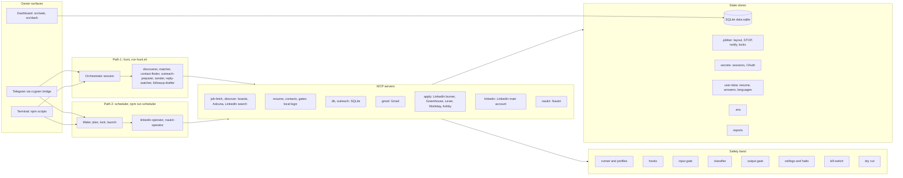

# Architecture

Audience: owner
Last verified against: cc51247
Source files: .mcp.json, src/mcp/, .claude/agents/, .claude/hooks/, .claude/settings.json, config/run-profiles.json, config/worker-tools.json, src/db.ts, src/scheduler/, src/outreach/limits.ts, src/safety/, src/layout/, src/web/, src/dash/, scripts/, run-hunt.sh

This page is the map. It shows what runs where, which store holds what, and where to
look first when something breaks. It does not restate safety rules: those live in
[CLAUDE.md](../CLAUDE.md) under "Outreach safety layers" and "Safety".

## The diagram

Mermaid version (renders on GitHub and most editors):



ASCII twin (same content, readable in a terminal):

```
 OWNER                 ENTRY PATHS                        MCP SERVERS (platform)
 -----                 -----------                        ----------------------
 Telegram (ccgram) --> PATH 1  HUNT  (run-hunt.sh)        job-fetch, discover (boards, Adzuna,
 Terminal scripts  -->   orchestrator                                          LinkedIn search)
 Dashboard (web)         |-> discoverer                   resume, contacts, gates (local logic)
   |                     |-> matcher (x batches of 5)     db, outreach (SQLite)
   |                     |-> contact-finder               gmail (Gmail)
   |                     |-> outreach-preparer (per job)  apply (LinkedIn burner, Greenhouse,
   |                     |-> sender                                  Lever, Workday, Ashby)
   |                     |-> reply-watcher                linkedin (LinkedIn main account)
   |                     '-> followup-drafter              naukri (Naukri)
   |
   |                   PATH 2  SCHEDULER (npm run scheduler)
   |                     wake: plan, lock, launch one bounded claude run
   |                       |-> linkedin-operator
   |                       '-> naukri-operator
   |
 SAFETY BAND (every tool call passes through it)
 [runner/profiles][hooks][input gate][classifier][output gate][ceilings/halts][kill switch][dry run]

 STATE STORES
 SQLite data.sqlite | .jobber/ (layout, STOP, notify, locks) | secrets/ (sessions, OAuth)
 user-data/ (resume, answers, languages) | .env | reports/
```

## Two entry paths

The hunt (`./run-hunt.sh`, started by `/runhunt` or by hand) is one orchestrating Claude
session that dispatches one subagent per pipeline stage and sees only compact JSON back.
It takes no run lock, so two hunts, or a hunt and a scheduler wake, can overlap; the
shared daily counters and the single-session LinkedIn lock are what keep them honest
(a collision shows up as `session_locked`). The scheduler (`npm run scheduler`) runs
outside the model: each wake reads the kill switch and halts, takes the shared run
lock named `run`, plans work from due counts and ceilings, then launches one bounded,
restricted `claude` run (profile `outreach_wake`) that dispatches the two operators.
Email follow-ups never come from the scheduler. Stage order and names: CLAUDE.md,
"Running the hunt" and "Scheduler". Owner procedures: [operations.md](operations.md),
[rollout.md](rollout.md), [scheduler-install.md](scheduler-install.md).

## Components in one place

| Component | Where | Notes |
|---|---|---|
| MCP servers | `.mcp.json`, `src/mcp/` | One file per server: job-fetch, resume, contacts, db, gates, apply, discover, naukri, linkedin, outreach. gmail is an external package. `src/mcp/email.ts` backs `npm run mcp:email`. |
| Stage and operator agents | `.claude/agents/` | Tool lists are in each file's frontmatter; operator tools also in `config/worker-tools.json`. |
| Run profiles | `config/run-profiles.json`, `scripts/run-claude.ts` | Exact tool names, allowlisted child env. |
| Permission sets | `config/permission-sets.json`, `scripts/permissions.ts` | Written to the git-ignored `.claude/settings.local.json`. |
| Hooks | `.claude/hooks/`, `.claude/settings.json` | tool-allowlist, kill-switch, block-outside-project, prompt-secret-guard. |
| Layout memory | `src/layout/`, `scripts/layout.ts` | See [layout-memory.md](layout-memory.md). |
| Outreach limits | `src/outreach/limits.ts`, `src/setup/limitsCatalog.ts` | Values: `npm run status -- limits`. |
| Scheduler | `src/scheduler/`, `scripts/scheduler.ts` | Wake plan, budgets, run log. |
| Dashboard | `src/web/`, `src/dash/`, `scripts/web.ts` | Login: [dashboard-login.md](dashboard-login.md). Exposure: [dashboard-exposure.md](dashboard-exposure.md). |
| Bring-up | `scripts/bootstrap.ts`, `scripts/setup.ts`, `scripts/stack.ts`, `scripts/dry-run.ts` | `bootstrap`, `setup`, `up`, `down`, `dry-run`. Setup modes: [setup-modes.md](setup-modes.md). |

## State stores

| Store | Holds | Who writes it |
|---|---|---|
| SQLite `data.sqlite` (schema in `src/db.ts`, plus `src/outreach/schema.ts` and `src/dash/authStore.ts`) | jobs, job_outcomes, job_exclusion_log, outreach, outreach_queue, followups, contacts, applications, connections, people, touches, contact_state, inbound_messages, processed_messages, reply_checks, escalations | MCP tools only |
| SQLite counters and halts | daily_counters, rate_events, halt_flags, dry_run_actions, scheduler_runs, scheduler_state | limits code, scheduler, kill switch |
| Dashboard auth (separate file under `.dashboard/`) | access_token, sessions, allowed_account, auth_mode, login_attempts, pending_login, audit_log, chat_pending | `src/dash/` |
| `.jobber/` | layout memory per platform, `STOP` file, notify log, run lock, bootstrap and verify records | scheduler, layout code, owner CLI |
| `secrets/` | LinkedIn and Naukri sessions, Gmail OAuth, lock files | owner login scripts |
| `user-data/` | resume, answers, languages, fact-gate allow-lists (shapes in `user-data.example/`) | owner only; the agent never edits `user-data/resume.json` |
| `.env` | credentials and limits, mode 600 | owner (setup wizard) |
| `reports/` | generated HTML funnel reports, git-ignored | `npm run report` |

## Which account does what

The `linkedin` MCP (search, check status, connect, message, accept invite, layout) uses
the main account only, in one locked headless session. The burner account is used only
by `apply.linkedin` (Easy Apply) and `discover.linkedin_*`. Never swap them. Authority:
CLAUDE.md, "Safety" rule 6. Session setup: [linkedin-sessions-setup.md](linkedin-sessions-setup.md).

## When X breaks, look here

Start with `npm run doctor` and `npm run status -- health`, then use the row that matches.

| Symptom or subsystem | First look | Second look | Doc |
|---|---|---|---|
| No new jobs found | `board_status` tool output, `config/portals.json` | `npx tsx scripts/check-portal.ts` for the slug, `src/sources/` | [config-reference.md](config-reference.md) |
| Board slug dead or portals file malformed | `config/portals.json` | `scripts/check-portal.ts` | [config-reference.md](config-reference.md) |
| All jobs excluded | `config/deal-breakers.json`, `config/target-regions.json` | `src/remotePolicy.ts`, `src/mcp/gates.ts` | [config-reference.md](config-reference.md) |
| Everything scores below threshold | `.claude/agents/matcher.md` | `src/mcp/db.ts` (`save_match_result` caps) | [operations.md](operations.md) |
| No contacts found | `.claude/agents/contact-finder.md` | `src/mcp/contacts.ts`, `src/lib/discoverOnly.ts` | [api-keys.md](api-keys.md) |
| Email not sent | `npm run status -- limits` | `.claude/agents/sender.md`, `.claude/hooks/kill-switch.cjs` | [operations.md](operations.md) |
| Nothing leaves in a "live" run | `src/safety/dryRun.ts` (flag precedence) | `npm run dry-run:report` | [operations.md](operations.md) |
| Resume or email blocked by fact gate | `src/resumeFacts.ts` | `user-data.example/` shapes, `src/mcp/resume.ts` | [config-reference.md](config-reference.md) |
| Style gate rejects outreach text | `src/safety/styleGate.ts` | `config/ai-tells.json` | [config-reference.md](config-reference.md) |
| LinkedIn action refused | `src/mcp/linkedin.ts` | `src/linkedin/verify.ts`, `npm run status -- working` | [operations.md](operations.md) |
| LinkedIn session locked or expired | `src/platform/lock.ts` | `scripts/save-linkedin-session.ts` | [linkedin-sessions-setup.md](linkedin-sessions-setup.md) |
| LinkedIn checkpoint or CAPTCHA halt | `npm run status -- working` | `scripts/linkedin-clear-halt.ts` (owner only) | [operations.md](operations.md) |
| Layout drift halt | `npm run layout -- status` | `src/layout/store.ts`, `src/layout/classify.ts` | [layout-memory.md](layout-memory.md) |
| Naukri blocked or empty | `src/sources/naukri.ts` | `src/mcp/naukri.ts`, `scripts/save-naukri-session.ts` | [naukri-session-setup.md](naukri-session-setup.md) |
| Classifier blocked a read or send | `src/safety/screen.ts` | `config/classifier-models.json`, `npm run models -- list` | [classifier-models.md](classifier-models.md) |
| Tool denied by hook | `.claude/hooks/tool-allowlist.cjs` | `config/run-profiles.json`, `config/worker-tools.json` | [operations.md](operations.md) |
| Path denied outside project | `.claude/hooks/block-outside-project.cjs` | `.claude/settings.json` | [operations.md](operations.md) |
| Everything denied | `scripts/killSwitch.ts` | `.claude/hooks/kill-switch.cjs`, `npm run jobber:control -- status` | [operations.md](operations.md) |
| Scheduler never wakes | `npm run scheduler -- --status` | `src/scheduler/plan.ts` (skip reasons), `src/scheduler/due.ts` | [scheduler-install.md](scheduler-install.md) |
| Scheduler run stops early | `src/scheduler/budget.ts` | `src/scheduler/runLog.ts` | [operations.md](operations.md) |
| Replies not detected | `.claude/agents/reply-watcher.md` | `config/replies.json`, `src/mcp/db.ts` | [operations.md](operations.md) |
| Follow-up not claimed | `.claude/agents/followup-drafter.md`, `.claude/agents/sender.md` | `src/mcp/db.ts` (`claim_followup_for_send`) | [operations.md](operations.md) |
| Apply returns manual_review | `src/applier/tools/open.ts` | `src/mcp/applier.ts` | [operations.md](operations.md) |
| Dashboard login fails | `src/dash/authStore.ts` | `src/web/server.ts`, `npm run dashboard -- status` | [dashboard-login.md](dashboard-login.md) |
| Setup or bring-up step fails | `npm run doctor` | `src/setup/steps/`, `scripts/stack.ts` | [setup-modes.md](setup-modes.md) |
| Permissions look wrong | `npm run permissions -- --status` | `config/permission-sets.json` | [operations.md](operations.md) |
| Backup or update did not run | `npm run backup -- --status`, `npm run auto-update -- --status` | `scripts/backup.ts`, `scripts/auto-update.ts` | [backup-and-restore.md](backup-and-restore.md) |
| Telegram silent | `scripts/ccgram/start.sh` | `src/platform/notify.ts`, `docs/telegram-bot-setup.md` | [telegram-bot-setup.md](telegram-bot-setup.md) |

## Known limits

Most platform paths here are unit-tested with fakes and not live-verified. See
CLAUDE.md, "Known limits and not yet live-verified", before trusting any row above
for a real LinkedIn, Naukri or Gmail failure.
